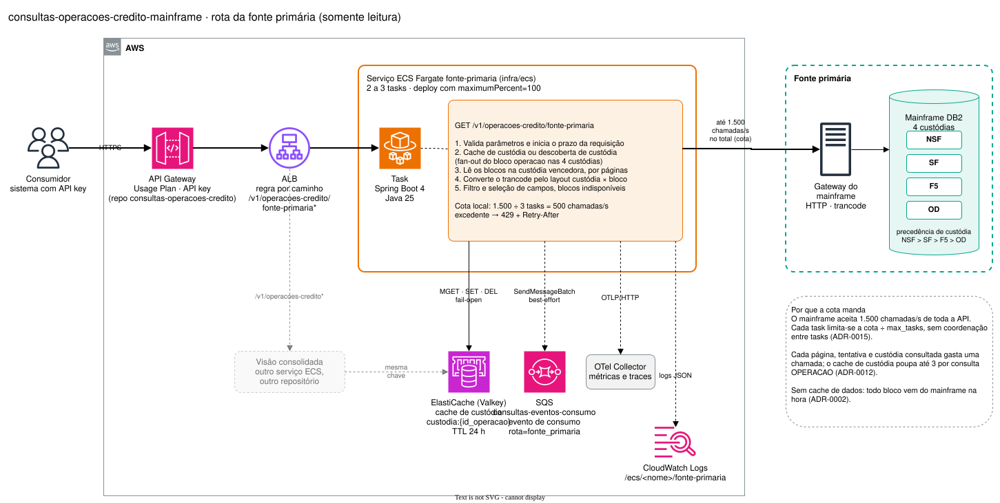

# consultas-operacoes-credito-mainframe

API REST, somente leitura, de consulta de operações de crédito da Custódia de Ativos PF direto na **fonte
primária** (gateway do mainframe). A visão consolidada (DynamoDB, com cache de blocos) roda em outro serviço,
do repositório `consultas-operacoes-credito` (ADR-0017); o ALB separa os dois pelo caminho.
Descrição completa em `docs/prompt_detalhes_2.md`; vocabulário em `GLOSSARY.md`; decisões em `docs/adr/`.

**Versão 2.0.1** — consultas `OPERACAO`, `CLIENTE` e `CONTA` na fonte primária, com `expand`, `fields` e
`filter`, cache de custódia no Valkey e um evento de consumo por requisição publicado no SQS.

| Versão | Mudança |
| --- | --- |
| 2.0.1 | Verificação de contrato (ADR-0017): as respostas reais da rota (200, 400, 404, 429, 503, 504) são validadas contra o `openapi.yaml` de `consultas-operacoes-credito`, e o `catalogo-campos.yml` local contra o de lá, em todo PR e push e num job diário que abre uma issue quando diverge. Sem mudança nas respostas |
| 2.0.0 | **Quebra:** repositório próprio da fonte primária (ADR-0017). Sai a rota da visão consolidada (`GET /v1/operacoes-credito` agora é 404), o DynamoDB, o cache de blocos, `consultas.rotas-ativas` e a métrica `consultas.cache`; artefato, imagem, `spring.application.name` e `service.name` passam a `consultas-operacoes-credito-mainframe`. As respostas de `/v1/operacoes-credito/fonte-primaria` não mudam |
| 1.4.0 | Múltiplas custódias (SF, F5, OD, NSF), paginação do mainframe, resposta parcial por bloco, resiliência por custódia e bloco, dois serviços ECS com cota local; ADRs 0012–0016 |
| 1.3.0 | Correções da revisão: parâmetro repetido e `conta` com mais de 20 dígitos viram 400; circuitos não contam falhas causadas pela própria API (prazo, pool, 4xx); máscara de dados pessoais nos spans; ADR-0009 |
| 1.2.0 | Evento de consumo no SQS (best-effort, em lote, HMAC de CPF/CNPJ e conta); contrato em `docs/eventos/evento-consumo.md` |
| 1.1.0 | `expand` com os 9 blocos (inclui `controles_iof`), `x-blocos-indisponiveis`, catálogo de campos, massa nova |
| 1.0.0 | Esqueleto do projeto e consulta `OPERACAO` com os blocos `operacao` e `originacao` |

## Documentação visual



Fluxo de uma consulta, componentes no código, diagrama de sequência e vídeo em
[`docs/arquitetura/`](docs/arquitetura/).

## Stack

Java 25, Spring Boot 4.2 (Spring MVC com virtual threads), AWS SDK v2 síncrono (só SQS), Maven (com wrapper).
Organização hexagonal em `br.com.consultas.operacoescredito`:

| Pacote | Conteúdo |
| --- | --- |
| `domain` | `Bloco`, `TipoConsulta`, `CriterioConsulta`, `Custodia`, `OperacaoConsultada`, o catálogo de campos em `domain.catalogo`, a seleção de campos em `domain.selecao` e o filtro em `domain.filtro` (sem framework) |
| `application` | Casos de uso `ConsultarOperacoesUseCase` e `RegistrarConsumoUseCase`, portas de saída `FonteDeOperacoes` e `PublicadorDeEventosDeConsumo` (sem framework) |
| `adapters.in.web` | Controller, validação dos parâmetros, Problem Details, contexto da requisição e evento de consumo |
| `adapters.out.fonteprimaria` | Gateway do mainframe: trancode, descoberta de custódia, paginação e resiliência |
| `adapters.out.cache` | Cache de custódia no Valkey (ADR-0012) |
| `adapters.out.eventos` | Publicação do evento de consumo no SQS (ADR-0004) |
| `config` | Ligação dos casos de uso às portas; leitura do catálogo de campos; observabilidade e resiliência |

As regras de dependência são verificadas pelo ArchUnit (`ArquiteturaTest`).

## Contrato

```
GET /v1/operacoes-credito/fonte-primaria?id_operacao=100000003&expand=parcelas,saldo,plano
x-tipo-consulta: OPERACAO
```

```
HTTP/1.1 200
x-blocos-indisponiveis: plano,saldo

{"data": [{"operacao": {...}, "originacao": {...}, "parcelas": [...], "plano": null, "saldo": null}]}
```

O contrato HTTP é definido em `consultas-operacoes-credito` (`contrato/openapi.yaml`, escrito à mão, e
`src/main/resources/catalogo-campos.yml`): este serviço é verificado contra ele, sem lib compartilhada (ADR-0017;
veja [Verificação de contrato](#verificação-de-contrato)). Mudança de contrato começa lá e é alinhada aqui.

O corpo é o mesmo contrato da visão consolidada (o mesmo JSON, byte a byte, para a mesma massa). Só a rota
exata `/v1/operacoes-credito/fonte-primaria` existe: qualquer outro caminho, inclusive `/v1/operacoes-credito`,
é 404 em Problem Details.

- `expand`: blocos separados por vírgula, com o nome canônico (o mesmo da chave no JSON):
  `operacao`, `originacao`, `componentes`, `parcelas`, `amortizacoes`, `recebimentos`, `plano`, `saldo`,
  `controles_iof`. `operacao` e `originacao` vêm sempre; repetições e espaços em volta dos nomes são ignorados.
- Cada parâmetro do contrato (`id_operacao`, `cpf_cnpj`, `conta`, `limite_operacoes`, `expand`, `fields`,
  `filter`) vai no máximo uma vez: listas vão separadas por vírgula no mesmo parâmetro. Repetido
  (`expand=parcelas&expand=saldo`, `filter=a&filter=b`) é 400, para que dois filtros não virem um "ou" sem aviso.
- Bloco pedido que a fonte primária não tem para a operação (404 do gateway) ou que falhou enquanto os demais
  responderam: chave com `null` e o bloco listado em `x-blocos-indisponiveis` (ordem canônica). Blocos-lista
  vazios (`[]`) não são indisponíveis.
- `fields`: `bloco.campo` separados por vírgula, com ponto também para campos aninhados
  (ex.: `fields=operacao.situacao_operacao_credito,saldo.saldo_parcelas.saldo_devedor`). Bloco sem campos
  listados volta completo; `id_operacao` volta sempre, em todo item de todo nível onde existe (`fields=operacao.id_operacao`
  reduz `operacao` a `{"id_operacao": ...}`); campo composto listado inteiro volta completo. A seleção é aplicada
  pelo caso de uso ao que a fonte devolveu, então vale para qualquer tipo de consulta.
- `filter`: RSQL avaliado em memória sobre o que a fonte devolveu, com seletor `<bloco>.<campo>` (caminho com
  ponto em campos aninhados) e comparação pelo tipo do catálogo. Operadores `==`, `!=`, `=lt=`/`<`, `=le=`/`<=`,
  `=gt=`/`>`, `=ge=`/`>=`, `=in=(a,b)`, `=out=(a,b)`; `;` é "e", `,` é "ou", parênteses agrupam. Ex.:
  `filter=parcelas.numero_parcela_amortizacao=ge=4;parcelas.situacao_parcela==ABERTA`.
  - Cada condição filtra só a sua lista: os itens do bloco-lista ou, em bloco-objeto, a primeira lista do
    caminho (`saldo.saldo_parcelas.saldo_devedor=gt=0`). Listas mais internas valem se algum item atende.
  - Em `operacao`/`originacao` a operação que não atende sai de `data` (consulta por operação: `{"data": []}`).
    Os dois blocos filtram o mesmo alvo (a operação), então podem ser ligados por `,` (ou):
    `operacao.situacao_operacao_credito==ATIVA,originacao.canal_contratacao==MOBILE`.
  - Campo nulo ou ausente só atende a `!=` e `=out=`; texto e booleano aceitam só `==`, `!=`, `=in=`, `=out=`.
  - 400: sintaxe inválida, bloco ou campo fora do catálogo, bloco fora do `expand`, campo composto, argumento
    fora do tipo, campo de primeiro nível de bloco-objeto que não seja `operacao`/`originacao`, ou `,` (ou)
    misturando listas diferentes.

| Situação | Status |
| --- | --- |
| Operação encontrada | 200 |
| Algum bloco pedido ausente ou indisponível na fonte primária | 200 + `x-blocos-indisponiveis` |
| Operação inexistente em todas as custódias | 404 (Problem Details) |
| Caminho fora da rota (inclusive `/v1/operacoes-credito`) | 404 (Problem Details) |
| `x-tipo-consulta` ausente/inválido (o detalhe lista os valores válidos, sem ecoar o recebido), `id_operacao` ausente/não numérico/com mais de 18 dígitos, parâmetro incoerente com o tipo (`cpf_cnpj`, `conta` ou `limite_operacoes` em `OPERACAO`; `id_operacao` em `CLIENTE`/`CONTA`), parâmetro do contrato repetido | 400 (Problem Details), sem chamar o gateway |
| Bloco desconhecido no `expand` (inclusive maiúsculas ou item vazio) | 400 (Problem Details listando os blocos válidos) |
| `fields` malformado, com bloco desconhecido, bloco fora do `expand` (sem expansão implícita) ou campo fora do catálogo | 400 (Problem Details listando blocos ou campos válidos) |
| `CLIENTE`/`CONTA` sem operações | 200 com `{"data": []}` |
| `cpf_cnpj` que não é CPF (11 dígitos) ou CNPJ (14 caracteres, alfanumérico em maiúsculas) com DV válido; `conta` com caractere não numérico ou mais de 20 dígitos; `limite_operacoes` fora de 1 a 500 | 400 (Problem Details) |
| Bloco `operacao` falhou, ou custódia indisponível na descoberta ou na lista de cliente/conta | 503 (Problem Details com `custodias_indisponiveis`) + `Retry-After` |
| Prazo da requisição esgotado | 504 (Problem Details sugerindo `limite_operacoes`, menos blocos no `expand` e a consulta por `OPERACAO`) |
| Cota do mainframe esgotada | 429 (Problem Details) + `Retry-After` |
| Trancode fora do layout no bloco `operacao` | 503 (Problem Details com `custodias_indisponiveis`) + `Retry-After`: sem um bloco `operacao` legível não se sabe se a operação está na custódia (ADR-0013) |

## Fonte primária

| Rota do gateway (trancode em texto) | Devolve |
| --- | --- |
| `GET /mainframe/custodias/{custodia}/operacoes/{id}/blocos/{bloco}` | Trancode do bloco naquela custódia (`bloco` em minúsculas, nome canônico); 404 se a operação ou o bloco não existe nela |
| `GET /mainframe/custodias/{custodia}/clientes/{cpf_cnpj}/operacoes` | Lista de `id_operacao` + `data_contratacao_operacao` das operações do cliente naquela custódia, sem ordem garantida (layout `lista_operacoes.yml`); 404 se não há nenhuma |
| `GET /mainframe/custodias/{custodia}/contas/{conta}/operacoes` | Idem, por conta |

`{custodia}` é `SF`, `F5`, `OD` ou `NSF` (ADR-0012). Toda rota de lista (blocos-lista e listas de cliente/conta) é
paginada (ADR-0016): a primeira página é pedida sem query param; as seguintes com
`?chave_continuacao=<chave>`, usando a chave (sem os espaços de preenchimento) que veio na página anterior.

- Gateway do mainframe via `@HttpExchange` (`GatewayMainframeClient`) sobre `RestClient` + Apache HttpClient 5
  com pool configurável e sem retry próprio.
- `OPERACAO`: com a custódia no cache de custódia, uma chamada por bloco pedido nela. Sem ela (descoberta,
  ADR-0012), o bloco `operacao` é pedido nas quatro custódias em paralelo; vale a de maior precedência entre as
  que o têm (`consultas.custodia.precedencia`, default `NSF > SF > F5 > OD`; repetida em mais de uma: WARN e
  `consultas.custodia.duplicada`), e os demais blocos são pedidos só nela. Se a custódia do cache não tem mais a
  operação (404), ela é esquecida e a descoberta é refeita uma vez (a operação pode migrar de custódia).
- `CLIENTE`/`CONTA`: a lista do cliente ou da conta nas quatro custódias, todas as páginas → junção (operação
  repetida fica com a custódia de maior precedência) → ordenação da mais recente para a mais antiga por data de
  contratação (no empate, maior `id_operacao` primeiro) → `limite_operacoes` aplicado → fan-out de uma chamada
  por operação selecionada × bloco, cada operação na sua custódia. Lista com 404 no gateway: nenhuma operação
  naquela custódia.
- Paginação (ADR-0016): no máximo 30 ocorrências por página, páginas lidas em sequência até a última ou até
  `consultas.fonte-primaria.paginacao.max-paginas` (20). Página que falha ou teto atingido: o bloco fica
  indisponível, nunca truncado (na lista de cliente/conta: 503).
- O fan-out roda em virtual threads (`Executors.newVirtualThreadPerTaskExecutor()` envolto por
  `ContextExecutorService`, sem features preview), com MDC, trace e correlationId propagados às threads filhas
  e no máximo `consultas.fonte-primaria.fan-out.max-chamadas-simultaneas` (default 16) chamadas em andamento
  por requisição; as demais esperam vaga (WARN se o prazo acabar esperando).
- O bloco `operacao` ganha o campo `custodia` (`SF`, `F5`, `OD` ou `NSF`), preenchido pela aplicação;
  filtrável (`filter=custodia==NSF`) e selecionável (`fields`).
- Resposta parcial (ADR-0013): falha de um bloco que não é `operacao` (circuito daquela custódia × bloco aberto,
  5xx depois do retry, timeout de uma tentativa, bulkhead cheio, trancode fora do layout, página que falhou)
  deixa só aquele bloco indisponível (`null` + `x-blocos-indisponiveis`, 200) e não afeta os outros. 404 de um
  bloco também o deixa `null`; sem o bloco `operacao`, a operação não existe (`OPERACAO`: 404 da API;
  `CLIENTE`/`CONTA`: a operação listada fica fora de `data`).
- Falhas que derrubam a requisição: o bloco `operacao` falhou, ou uma custódia não respondeu na descoberta ou
  na lista sem a qual não se pode afirmar o resultado → **503** com `Retry-After` e a propriedade
  `custodias_indisponiveis` no Problem Details (nunca 404 falso nem lista incompleta); prazo da requisição
  esgotado → **504** (sugerindo `limite_operacoes`, menos blocos no `expand` ou a consulta por `OPERACAO`);
  cota do mainframe esgotada → **429** com `Retry-After`. 504 e 429 interrompem as chamadas em andamento.
- `x-correlationid` é repassado em toda chamada ao gateway; o `traceparent` (W3C) é propagado pela
  observação do `RestClient`.

### Resiliência da fonte primária

Proteção do Resilience4j separada por rota (ADR-0014), aplicada a cada chamada ao gateway, de fora para dentro:
retry → circuit breaker → rate limiter → bulkhead de CLIENTE/CONTA (só nessas consultas) → bulkhead da custódia.
Circuito e retry existem por custódia × bloco (ou lista):
`fontePrimaria-<CUSTODIA>-<bloco|lista_cliente|lista_conta>`, ex.: `fontePrimaria-F5-parcelas`, criados na primeira
chamada a partir da base `resilience4j.*.instances.fontePrimaria`; uma instância declarada com o nome exato
sobrescreve a base daquela rota. A classificação das falhas fica em `FalhasDoGateway` (ADR-0009).

| Mecanismo | Comportamento | Resposta |
| --- | --- | --- |
| Prazo da requisição | `consultas.prazo.fonte-primaria.*` (OPERACAO 2,5 s, CLIENTE/CONTA 6 s; mainframe com p50 de 220 ms e p99 de 500 ms por chamada), contado desde a entrada da requisição. Limita a espera por vaga no fan-out, a abertura da conexão TCP (`timeout-conexao`, 50 ms), a espera por conexão do pool e pela resposta de cada tentativa (`timeout-resposta`, 700 ms) e o fan-out como um todo (ADR-0006) | 504 com as sugestões |
| Retry | Só o do Resilience4j (o Apache HttpClient não retenta): 1 tentativa extra (cada tentativa consome a cota), backoff de 10 ms com jitter de 50%. Só para 5xx, 429 do mainframe e falha/timeout ao **abrir** a conexão; nunca 4xx, timeout de resposta, timeout do pool, circuito aberto, bulkhead ou rate limiter. Só se ainda restar `consultas.fonte-primaria.retry.prazo-minimo-restante` (600 ms) do prazo | a falha da última tentativa |
| Circuit breaker (por custódia × bloco) | Janela de 10 s, mínimo 10 chamadas, abre com 50% de falhas (5xx e falhas de I/O, inclusive timeouts que tiveram o tempo configurado inteiro; 4xx e 404 contam como sucesso), 5 s aberto. Não contam: chamadas interrompidas, timeouts encurtados pelo prazo da requisição e recusas do rate limiter e do bulkhead. Meio-aberto com 16 chamadas (= `max-chamadas-simultaneas`) | bloco indisponível; 503 se for o bloco `operacao` ou uma lista |
| Bulkhead `fontePrimaria-cliente-conta` (semáforo) | Só chamadas de consultas CLIENTE/CONTA: 160 simultâneas, espera de até 10 ms. Abaixo do pool: sempre sobram 80 conexões para OPERACAO | idem |
| Bulkhead `fontePrimaria-<CUSTODIA>` (semáforo) | Por custódia: 120 simultâneas (metade do pool de 240), espera de até 10 ms. Uma custódia lenta não toma as vagas das outras | idem |
| Rate limiter `fontePrimaria` (cota) | Cota do mainframe dividida pelas tasks do serviço: `consultas.fonte-primaria.cota.chamadas-por-segundo` (1500) ÷ `max-tasks` (3) = 500/s por task, em períodos de 100 ms (50 permissões), sem fila. Cada tentativa e cada página consome uma permissão. Local, sem coordenação entre tasks; o serviço é publicado com `maximumPercent=100` para nunca passar de `max-tasks` (ADR-0015) | 429 + `Retry-After` |

Cada tentativa tem span e timer `consultas.dependencia` próprios, com a tag `custodia`. O Resilience4j publica
`resilience4j.circuitbreaker.*`, `resilience4j.retry.calls`, `resilience4j.bulkhead.*` e
`resilience4j.ratelimiter.*` com as tags `name` (ex.: `fontePrimaria-F5-parcelas`), `kind` e `state`, sem
identificadores. A descoberta é medida por `consultas.custodia.descoberta{rota,custodia,resultado}`
(`encontrada`, `nao_encontrada`, `indisponivel`, `cache`).

Logs WARN (logger `resiliencia`) de todas as instâncias, inclusive Valkey e SQS: toda tentativa de
retry (instância, tentativa N de M, espera e motivo) e o retry esgotado; toda transição de circuit breaker, com
as taxas de falha e de lentidão e os limiares; recusas (circuito aberto, bulkhead cheio, rate limiter sem
permissão) amostradas a uma linha por instância a cada 5 s, com quantas foram suprimidas.

### Trancode

- Cada trancode é lido por um parser genérico dirigido por layouts YAML (validados na subida). Mudar o
  template = editar o YAML:
  - `src/main/resources/trancode/layouts/<bloco>.yml`: layout base, usado pela SF e por toda custódia sem
    override;
  - `src/main/resources/trancode/layouts/<CUSTODIA>/<bloco>.yml`: override opcional da custódia, no mesmo
    formato (`bloco:` igual ao nome do arquivo). Campo que a custódia não tem fica fora do layout e ausente na
    saída; campo que ela tem e o contrato não (fora do catálogo) é declarado com `ignorar: true` e pulado.

```yaml
bloco: saldo
estrutura: objeto            # objeto: um registro | lista: páginas de registros (abaixo)
registro:
  campos:                    # posições fixas; inicio a partir de 1, relativo ao registro
    - { campo: id_operacao, inicio: 1, tamanho: 18, tipo: numero }
    - { campo: saldo_devedor_operacao, inicio: 19, tamanho: 15, tipo: decimal, formato: 2 }
    - { campo: data_posicao_calculo, inicio: 39, tamanho: 10, tipo: data, formato: yyyy-MM-dd }
  listas:                    # sub-listas após a parte fixa, na ordem declarada: prefixo de 3 dígitos com a
    - campo: saldo_parcelas  # quantidade + registros, sem paginação
      registro: { campos: [ ... ] }
```

Um layout com `estrutura: lista` (blocos-lista e `lista_operacoes`) é paginado: cada resposta é uma página com
no máximo 30 ocorrências (ADR-0016).

| Posição | Tamanho | Conteúdo |
| --- | --- | --- |
| 1 | 3 | Quantidade de ocorrências nesta página (`000` a `030`) |
| 4 | 1 | Indicador de continuação: `S` há mais páginas, `N` última página |
| 5 | 20 | Chave de continuação, alinhada à esquerda e completada com espaços; em branco quando o indicador é `N` |
| 25 | — | As ocorrências, uma após a outra, com o tamanho do registro do layout |

Lista vazia = `000N` seguido de 20 espaços. A chave é opaca para a API: nos stubs locais é o nome do bloco
(até 14 caracteres) seguido da posição da próxima ocorrência com 6 dígitos (ex.: `PARCELAS000031`).

Diferenças de layout por custódia na massa local (de propósito, para exercitar o parser):

| Custódia | Layout | Diferença |
| --- | --- | --- |
| F5 | `F5/originacao.yml` | sem `dependencia_contabil` (registro de 38 posições); o campo fica ausente na resposta |
| OD | `OD/operacao.yml` | `codigo_produto_od` (texto, posição 34, tamanho 6, `ignorar: true`) no meio do registro; `data_contratacao_operacao`, `data_baixa_operacao` e `cpf_cnpj` deslocados 6 posições (40, 50 e 60) |
| NSF | `NSF/parcelas.yml` | mesmos campos, outra ordem: `situacao_parcela` (25), `valor_juros_principal_parcela` (40), `valor_principal_parcela` (55), `data_vencimento_parcela` (70) |

| `tipo` | `formato` | Conversão |
| --- | --- | --- |
| `numero` | — | inteiro com zeros à esquerda |
| `decimal` | casas implícitas (ex.: `2`) | `BigDecimal` com essa escala |
| `data` / `data_hora` | padrão do `DateTimeFormatter` | string `yyyy-MM-dd` / `yyyy-MM-ddTHH:mm:ss`; leitura estrita (data inexistente, como `2024-02-30`, é trancode inválido → 502) |
| `booleano` | caracteres de verdadeiro e falso (default `SN`) | `true`/`false` |
| `texto` | — | string sem os brancos das pontas |

Campo todo em branco vira `null`; data ou data-hora só de zeros (`0000-00-00`, `00000000`) também, convenção do
mainframe para "sem data" (ex.: `data_baixa_operacao` de operação ativa). Os layouts não têm sinal.

## Cache de custódia (Valkey)

O cache guarda só **em qual custódia** cada operação foi encontrada, nunca dados da operação (ADR-0002,
ADR-0012). A chave `custodia:{id_operacao}`, o valor (o código da custódia, ex.: `SF`) e o TTL
(`consultas.cache.ttl-custodia`, 24 h) são **contrato com o serviço da visão consolidada**, que usa o mesmo
Valkey (ADR-0017): mudar qualquer um dos três exige mudar os dois serviços.

- `OPERACAO`: um `MGET` de uma chave antes da descoberta; custódia achada pula a descoberta. Valor fora do
  formato conta como ausente. Custódia descoberta é gravada; custódia que não tem mais a operação é removida
  (`DEL`) e a descoberta é refeita.
- `CLIENTE`/`CONTA`: a custódia de cada operação da lista é gravada (até `max-chaves-por-consulta`, 500; acima,
  nada é gravado), em `SET ... PX` de uma chave em rodadas de `chaves-por-comando` (100) em pipeline.
- Gravações e remoções rodam **fora da requisição** (virtual thread), no máximo `max-gravacoes-simultaneas` (32)
  em andamento; sem vaga, descartadas.
- Com menos de `prazo-minimo-restante` (20 ms) do prazo da requisição, nem lê.
- Premissa: Valkey standalone ou replication group, sem cluster mode. Só comandos de uma chave e `MGET`.
- Fail-open: o Valkey é só otimização. Timeout curto do cliente (`spring.data.redis.timeout`, 10 ms; conexão em
  `connect-timeout`, 20 ms, para que um host inalcançável custe pouco até o circuito abrir) e circuit breaker
  próprio (`resilience4j.circuitbreaker.instances.valkey`); erro, lentidão ou circuito aberto = "não sei" e a
  consulta faz a descoberta, com a mesma resposta. O Valkey não entra no health/readiness.
- Cliente Lettuce (Spring Data Redis) com uma conexão compartilhada e multiplexada; sem pool.
- `consultas.cache.habilitado=false` desliga o cache (toda consulta `OPERACAO` faz a descoberta).

## Evento de consumo (SQS)

Cada requisição à rota de consulta, com sucesso ou erro, gera um evento de consumo publicado na fila SQS
`consultas-eventos-consumo` (ADR-0004, ADR-0008), para outro serviço levar a Firehose → S3 → Athena. Contrato
(campos, códigos de erro, evolução por `versao_evento`) em [`docs/eventos/evento-consumo.md`](docs/eventos/evento-consumo.md).

- JSON plano em `snake_case`: `versao_evento`, `timestamp`, `correlation_id`, `trace_id`, `consumidor`, `rota`
  (sempre `fonte_primaria` neste serviço), `tipo_consulta`, `id_operacao`, `cpf_cnpj_hmac`, `conta_hmac`,
  `blocos_solicitados`, `campos_solicitados`, `filtro`, `limite_operacoes`, `quantidade_operacoes_retornadas`,
  `blocos_indisponiveis`, `cache_hits` e `cache_misses`, `status_http`, `codigo_erro`, `duracao_ms`.
- `cache_hits` e `cache_misses` contam o cache de blocos, que só existe na visão consolidada: aqui vêm sempre
  como objetos vazios, para o schema continuar o mesmo nos dois serviços.
- CPF/CNPJ e conta só como HMAC-SHA256 (hex) com `consultas.eventos.segredo-hmac`, também dentro do `filtro`
  (com ou sem pontuação: `529.982.247-25` dá o mesmo HMAC de `52998224725`); nunca em claro. Blocos e campos
  malformados ficam fora do evento. `consumidor` é o mesmo valor normalizado de logs e métricas.
- Montado no fim do `ContextoRequisicaoFilter` (`RegistroDeConsumoHttp`).
- **Best-effort e assíncrono**: a requisição só põe o evento numa fila em memória limitada
  (`consultas.eventos.fila.capacidade`, 10.000); uma virtual thread monta lotes de até 10 (ou o que houver 1 s depois
  do primeiro evento) e envia cada lote num `SendMessageBatch`, em outra virtual thread. A requisição nunca espera
  o SQS nem falha por ele.
- Fila cheia, bulkhead sem vaga, circuito aberto, falha do SQS ou encerramento → evento descartado e contado em
  `eventos.consumo.descartados` (tag `motivo`).
- Resiliência própria: circuit breaker `sqs` (janela de 20, mínimo 5, 50% de falhas, 10 s aberto), bulkhead `sqs`
  (4 envios simultâneos, espera de até 1 s por vaga), timeout por tentativa (1 s) e da chamada (3 s) e retry só do
  SDK (`standard`).
- Encerramento gracioso: depois que o servidor web para de atender, o que restou na fila é enviado por até
  `consultas.eventos.fila.tempo-maximo-drenagem` (10 s) no total, envios em andamento incluídos. Todo evento
  termina enviado ou contado: o que não sai no tempo (ou chega à fila durante o encerramento) conta como
  `encerramento`. Uma falha inesperada no drenador descarta só aquele lote (`falha_envio`) e ele segue.
- `consultas.eventos.habilitado=false` desliga o evento (nada é montado nem enviado). Ligado, `segredo-hmac` (pelo
  menos 32 bytes, ex.: `openssl rand -base64 48`) e `sqs.url-fila` são obrigatórios (a aplicação não sobe sem
  eles). O segredo nunca aparece no `toString()` das propriedades.

## Catálogo de campos

`src/main/resources/catalogo-campos.yml` (importado pelo `application.yml`) declara, para cada bloco, a
estrutura (`objeto` ou `lista`) e os campos com nome, tipo e `anulavel` (ADR-0005). Tipos: `numero`,
`decimal`, `data` (`yyyy-MM-dd`), `data_hora` (`yyyy-MM-ddTHH:mm:ss`), `texto`, `booleano`, e os compostos
`objeto`/`lista`, que declaram os próprios campos (ex.: `plano.dados_plano_amortizacao.encargos_moratorios`,
`saldo.saldo_parcelas`). Os blocos continuam trafegando como `Map`, com decimais em `BigDecimal`.

O catálogo é validado na subida (um bloco por `Bloco`, `id_operacao` numérico em todo bloco, compostos com
subcampos, nomes únicos) e valida o `fields` e valida e tipa o `filter`. Incluir ou remover campo = editar o YAML.

## Contexto da requisição e logs

Um filtro (`ContextoRequisicaoFilter`) roda antes de qualquer processamento em toda rota fora de `/actuator`:

| Header | Regra |
| --- | --- |
| `x-correlationid` | Até 64 caracteres `[A-Za-z0-9-]`. Ausente: UUID gerado. Inválido: 400 (com um UUID novo). Sempre devolvido na resposta |
| `x-consumidor` | Sem espaços nas pontas. Ausente: `desconhecido`. Fora de `[A-Za-z0-9._-]{1,64}`: `invalido` (o valor recebido não vai a log, evento nem métrica) |

- `correlation_id`, `consumidor`, `tipo_consulta` (ou `invalido`) e `rota` vão para o MDC e, ao final, só essas
  chaves são removidas (as do tracing, como `traceId`/`spanId`, ficam com quem as pôs). Todo Problem Details traz a
  propriedade `correlation_id`.
- Rota, consumidor, tipo de consulta e blocos pedidos são lidos por uma única regra (`RequisicaoDeConsulta`) para
  MDC, log de acesso, evento de consumo, prazo e métricas; só a rota exata `/v1/operacoes-credito/fonte-primaria`
  gera evento e conta em `consultas.blocos`.
- Logs em JSON (structured logging ECS do Spring Boot) por um `AsyncAppender` (`logback-spring.xml`).
  Perfil `human-logs` para texto legível em desenvolvimento.
- Um log de acesso por requisição (logger `acesso`): `metodo`, `uri`, `blocos`, `status`, `duracao_ms`,
  `cache_hits` e `cache_misses` (sempre objetos vazios, como no evento), parâmetros informados (`id_operacao`,
  `cpf_cnpj`, `conta`, `limite_operacoes`, `fields`, `filter`) e o MDC.
- CPF/CNPJ e conta saem sempre mascarados (`529******25`, `***********5874`) em todo log: campos com esses
  nomes, segmentos de rota `/clientes/<cpf_cnpj>` e `/contas/<conta>` (URLs do gateway do mainframe), pares
  `chave=valor`/RSQL/JSON e CPF/CNPJ soltos com DV válido (`MascaramentoLogCustomizer`).
- O MDC chega às threads filhas por Micrometer Context Propagation (`MdcThreadLocalAccessor`): envolver a
  tarefa com `ContextSnapshotFactory.captureAll().wrap(...)` ou o executor com `ContextExecutorService.wrap(...)`.

## Métricas e traces

Micrometer + OpenTelemetry (`spring-boot-starter-opentelemetry`): a aplicação exporta métricas
(`OtlpMeterRegistry`) e traces (bridge Micrometer Tracing → OpenTelemetry SDK) por OTLP/HTTP para o
OpenTelemetry Collector, que manda métricas ao Prometheus e traces ao Jaeger. Nada de fornecedor no código:
trocar para Datadog é trocar o exporter em `observabilidade/otel-collector.yaml`. O `service.name` é
`consultas-operacoes-credito-mainframe` (o `spring.application.name`).

| Métrica | Tags |
| --- | --- |
| `http.server.requests` (timer) | `consumidor`, `tipo_consulta` (`nenhum`/`invalido` quando ausente/inválido), `rota` (`fonte_primaria`), `status`, `uri` (`/v1/operacoes-credito/fonte-primaria`), `method`, `outcome`, `exception` |
| `consultas.blocos` (contador, um incremento por bloco pedido) | `bloco`, `consumidor`, `tipo_consulta`, `rota`, `status` |
| `consultas.dependencia` (timer, um por chamada externa) | `dependencia` (`fonte_primaria`, `valkey`, `sqs`), `operacao` (o bloco, `lista_operacoes_cliente` ou `lista_operacoes_conta` na fonte primária; `MGET`/`SET`/`DEL` no Valkey; `SendMessageBatch` no SQS), `custodia` (fonte primária) |
| `consultas.custodia.descoberta`, `consultas.custodia.duplicada` | `rota`, `custodia`, `resultado` |
| `resilience4j.circuitbreaker.*` (estado, chamadas) | `name` (`valkey`, `fontePrimaria-<CUSTODIA>-<bloco>`, `sqs`), `state`/`kind` |
| `resilience4j.bulkhead.*`, `resilience4j.ratelimiter.*` | `name` (`fontePrimaria`, `fontePrimaria-<CUSTODIA>`, `fontePrimaria-cliente-conta`, `sqs`) |
| `eventos.consumo.enviados` (contador; Prometheus `eventos_consumo_enviados_total`) | — |
| `eventos.consumo.descartados` (contador; Prometheus `eventos_consumo_descartados_total`) | `motivo` (`fila_cheia`, `bulkhead_cheio`, `circuito_aberto`, `falha_envio`, `encerramento`) |
| `eventos.consumo.fila` (gauge, eventos aguardando envio) | — |
| `consultas.etapa` (timer, um por etapa interna) | `etapa` (`lista_operacoes`, `fan_out`, `filtro`) |

- `x-consumidor` vira tag como veio (id da API key no gateway); fora de `[A-Za-z0-9._-]{1,64}` vira `invalido`.
  Bloco fora do catálogo não vira tag. `id_operacao`, CPF/CNPJ e conta nunca são tag de métrica.
- Spans: um por requisição HTTP (com `consumidor`, `tipo_consulta`, `rota`, `correlation_id` e os
  identificadores da consulta), com filhos por etapa e por chamada externa. `traceparent` (W3C) recebido
  continua o trace e segue para o gateway da fonte primária.
  - `fan_out` (atributo `operacoes`) com um `fonte_primaria <bloco>` por operação × bloco pedido; 404 (bloco
    inexistente) não é erro. Em `CLIENTE`/`CONTA`, antes dele, a etapa `lista_operacoes` com a chamada
    `fonte_primaria lista_operacoes_cliente` (ou `_conta`).
  - `valkey MGET` do cache de custódia e, fora da requisição, `valkey SET`/`DEL`.
  - `filtro`, quando há `filter`.
- Novos adapters e etapas usam `Observacoes.dependencia(...)` e `Observacoes.etapa(...)`
  (`config.observabilidade`), que fixam nomes e tags. A camada de aplicação mede etapas pela porta
  `ObservadorDeEtapas`, sem depender de Micrometer.
- CPF/CNPJ e conta saem mascarados em tudo o que o span leva de texto: nome, atributos, eventos (inclusive
  `exception.message` e `exception.stacktrace`, que trazem a URL do gateway com o documento ou a conta) e
  descrição do status (`MascaramentoSpanExporter`, que envolve todo exportador de span). O Collector mascara de
  novo, como defesa em profundidade (processor `transform/mascaramento`).
- Buckets de histograma nos prazos do requisito não funcional (`management.metrics.distribution.slo`).
- A aplicação amostra 100%; o **tail sampling** do Collector guarda todo trace com erro, com status 5xx ou
  lento e 10% do resto.
- `/actuator/metrics` exposto para inspeção.

## Subir o ambiente local

Pré-requisito: Docker.

```bash
docker compose up -d --build --wait
curl -H "x-tipo-consulta: OPERACAO" "http://localhost:8080/v1/operacoes-credito/fonte-primaria?id_operacao=100000001"
docker compose down -v
```

O `docker-compose.yml` sobe:

- **WireMock `3.13.2`** (porta 8089), simulando o gateway do mainframe com os stubs de `wiremock/mappings`.
- **Valkey `9.0.8-alpine`** (porta 6379), cache de custódia, sem persistência.
- **RedisInsight** `redis/redisinsight:3.8.0` em http://localhost:5540, para ver o cache: no primeiro acesso,
  aceite os termos; a conexão *valkey (cache local)* aparece pré-configurada, e cada chave
  `custodia:{id_operacao}` mostra a custódia e o TTL restante.
- **LocalStack Community `4.14.0`**, a última tag que roda sem auth token (ADR-0003). Uso exclusivo em
  desenvolvimento local: a tag não recebe patches de segurança. Só o serviço `sqs`: o script
  `localstack/init/ready.d/00-eventos-consumo.sh` cria a fila `consultas-eventos-consumo`; para ver os eventos:
  `docker compose exec localstack awslocal sqs receive-message --queue-url
  http://localhost:4566/000000000000/consultas-eventos-consumo --max-number-of-messages 10`.
- **app**, construída pelo `Dockerfile`.
- **OpenTelemetry Collector** `otel/opentelemetry-collector-contrib:0.165.0` (OTLP em `4317`/`4318`).
- **Jaeger v2** `jaegertracing/jaeger:2.23.0`: traces em http://localhost:16686.
- **Prometheus** `prom/prometheus:v3.16.0`: http://localhost:9090.
- **Grafana** `grafana/grafana:13.3.1`: http://localhost:3000 (anônimo, somente leitura; `admin`/`admin`
  para editar). Datasources Prometheus e Jaeger e o dashboard *Consultas de Operações de Crédito*
  (latência por tipo de consulta, latência por dependência, erros, blocos mais pedidos, consumo
  por consumidor, custódias, resiliência e cota) são provisionados de `observabilidade/grafana/`.

### Massa local

Os stubs de `wiremock/mappings` são a massa: `<id_operacao>.json` com o trancode de cada bloco em cada custódia
(paginado nas listas) e `clientes.json`/`contas.json` com a lista de operações de cada cliente e conta em cada
custódia. Os mesmos stubs sobem no docker-compose e nos testes. Até a 1.4.0 eles eram gerados a partir da massa
da visão consolidada; o gerador ficou no repositório `consultas-operacoes-credito` (ADR-0017), e aqui os stubs
são versionados e editados direto.

| `id_operacao` | Custódia | Situação | CPF/CNPJ | Conta | Cenário |
| --- | --- | --- | --- | --- | --- |
| 100000001 | SF | ATIVA | 52998224725 | 434115000065874 | 12 parcelas, 5 pagas, parcela 6 com amortização parcial e 2 dias de atraso |
| 100000002 | SF | LIQUIDADA | 52998224725 | 434115000065874 | antecipação liquidando 3 parcelas (`BAIXA_INTEGRAL_MAIS_UMA_PARCELA`) |
| 100000003 | F5 | ATIVA | 52998224725 | 434115000099991 | sem recebimentos; **sem os blocos `plano` e `saldo`**; sem `dependencia_contabil` (F5) |
| 100000004 | OD | ATIVA | 12ABC34501DE35 (CNPJ alfanumérico) | 434115000077712 | 10 parcelas, 3 pagas; trancode do `operacao` com o campo ignorado da OD |
| 100000005 | NSF | LIQUIDADA | 12ABC34501DE35 | 434115000077712 | 4 parcelas pagas no vencimento; trancode de `parcelas` na ordem da NSF |
| 100000006 | SF **e** NSF | ATIVA (SF) / `ATIVA_NSF` (NSF) | 11144477735 | 434115000088823 | 8 parcelas, 2 pagas; **duplicada**: mesmos blocos nas duas custódias, só a situação muda; a NSF vence (precedência NSF > SF > F5 > OD) |
| 100000007 | F5 | ATIVA | 39053344705 | 434115000070007 | 75 parcelas, 34 pagas no vencimento: no trancode, `parcelas` e `controles_iof` em 3 páginas (30 + 30 + 15), `amortizacoes` e `recebimentos` em 2 (30 + 4) |
| 100000101 a 100000114 | rodízio SF, F5, OD, NSF (101 SF, 102 F5, 103 OD, 104 NSF, 105 SF...) | ATIVA | 11222333000181 | 434115000055501 | 14 operações mensais (2025-09-03 a 2026-10-03), 2 parcelas, sem recebimentos; as F5 sem `dependencia_contabil` |

O cliente 52998224725 tem três operações em duas contas (SF e F5); a conta 434115000065874 e a
434115000077712 têm duas operações cada. O cliente 11222333000181 (e a conta 434115000055501) tem 14
operações nas quatro custódias. Uma custódia em que o cliente ou a conta não tem operação não tem stub de
lista (404).

Para rodar a aplicação fora do Docker contra o compose:

```bash
docker compose up -d --wait wiremock valkey localstack
AWS_REGION=sa-east-1 \
CONSULTAS_FONTE_PRIMARIA_URL=http://localhost:8089 \
CONSULTAS_EVENTOS_SQS_ENDPOINT=http://localhost:4566 \
CONSULTAS_EVENTOS_SQS_URL_FILA=http://localhost:4566/000000000000/consultas-eventos-consumo \
CONSULTAS_EVENTOS_SQS_CREDENCIAIS_ACCESS_KEY_ID=test CONSULTAS_EVENTOS_SQS_CREDENCIAIS_SECRET_ACCESS_KEY=test \
CONSULTAS_EVENTOS_SEGREDO_HMAC=segredo-local-somente-desenvolvimento \
./mvnw spring-boot:run
```

(Ou `CONSULTAS_EVENTOS_HABILITADO=false` no lugar das variáveis `CONSULTAS_EVENTOS_*`, sem evento de consumo.)

## Configuração

| Propriedade | Variável | Default |
| --- | --- | --- |
| `consultas.cache.habilitado` | `CONSULTAS_CACHE_HABILITADO` | `true` |
| `consultas.cache.ttl-custodia` | — | `24h` (contrato com a visão consolidada) |
| `spring.data.redis.host` / `.port` (Valkey) | `CONSULTAS_VALKEY_HOST` / `CONSULTAS_VALKEY_PORTA` | `localhost` / `6379` |
| `spring.data.redis.timeout` (comando no Valkey) | `CONSULTAS_VALKEY_TIMEOUT` | `10ms` |
| `spring.data.redis.connect-timeout` | `CONSULTAS_VALKEY_CONNECT_TIMEOUT` | `20ms` |
| `consultas.cache.chaves-por-comando` / `.max-chaves-por-consulta` / `.prazo-minimo-restante` / `.max-gravacoes-simultaneas` | `CONSULTAS_CACHE_MAX_CHAVES_POR_CONSULTA` (`max-chaves-por-consulta`) | `100` / `500` / `20ms` / `32` |
| `resilience4j.circuitbreaker.instances.valkey.*` | — | janela de 20 chamadas, mínimo 10, abre com 50% de falhas, 5 s aberto, 3 chamadas em meio-aberto |
| `consultas.fonte-primaria.url` | `CONSULTAS_FONTE_PRIMARIA_URL` | `http://localhost:8089` |
| `consultas.fonte-primaria.layouts` | — | `classpath:trancode/layouts/` |
| `consultas.fonte-primaria.cota.chamadas-por-segundo` / `.max-tasks` | `CONSULTAS_FONTE_PRIMARIA_COTA_CHAMADAS_POR_SEGUNDO` / `CONSULTAS_FONTE_PRIMARIA_COTA_MAX_TASKS` | `1500` / `3` (ADR-0015) |
| `consultas.fonte-primaria.pool.*` | — | ver `application.yml` (pool de 240 conexões; timeouts limitados ao prazo restante) |
| `consultas.fonte-primaria.fan-out.max-chamadas-simultaneas` | `CONSULTAS_FONTE_PRIMARIA_MAX_CHAMADAS_SIMULTANEAS` | `16` (teto de chamadas ao gateway em andamento por requisição; mínimo 1) |
| `consultas.fonte-primaria.paginacao.max-paginas` | — | `20` |
| `consultas.fonte-primaria.retry.prazo-minimo-restante` | — | `600ms` (só retenta se restar isto do prazo da requisição) |
| `consultas.prazo.fonte-primaria.operacao` / `.cliente` / `.conta` | — | `2500ms` / `6s` / `6s` (prazo da requisição → 504) |
| `consultas.custodia.precedencia` | — | `NSF, SF, F5, OD` |
| `resilience4j.*.instances.fontePrimaria*` | — | ver a tabela de resiliência acima |
| `consultas.eventos.habilitado` | `CONSULTAS_EVENTOS_HABILITADO` | `true` |
| `consultas.eventos.segredo-hmac` | `CONSULTAS_EVENTOS_SEGREDO_HMAC` | vazio (obrigatório com o evento ligado; em produção, de um cofre de segredos) |
| `consultas.eventos.fila.capacidade` | `CONSULTAS_EVENTOS_CAPACIDADE_FILA` | `10000` |
| `consultas.eventos.fila.tamanho-lote` / `.intervalo-envio` / `.tempo-maximo-drenagem` | — | `10` (1 a 10) / `1s` / `10s` |
| `consultas.eventos.sqs.url-fila` | `CONSULTAS_EVENTOS_SQS_URL_FILA` | vazio (obrigatório com o evento ligado) |
| `consultas.eventos.sqs.endpoint` | `CONSULTAS_EVENTOS_SQS_ENDPOINT` | vazio (endpoint da AWS) |
| `consultas.eventos.sqs.regiao` | `AWS_REGION` | `sa-east-1` |
| `consultas.eventos.sqs.credenciais.*` | `CONSULTAS_EVENTOS_SQS_CREDENCIAIS_ACCESS_KEY_ID` / `..._SECRET_ACCESS_KEY` | vazio (cadeia padrão do SDK) |
| `consultas.eventos.sqs.timeout-tentativa` / `.timeout-chamada` | — | `1s` / `3s` |
| `resilience4j.circuitbreaker.instances.sqs.*` | — | janela `COUNT_BASED` de 20, mínimo 5 chamadas, 50% de falhas, 10s aberto, 2 chamadas no meio-aberto |
| `resilience4j.bulkhead.instances.sqs.*` | — | `max-concurrent-calls` 4, `max-wait-duration` 1s |
| Endpoint OTLP (traces e métricas) | `OTEL_EXPORTER_OTLP_ENDPOINT` | `http://localhost:4318` (só métricas; traces só com a variável) |
| `management.opentelemetry.resource-attributes.deployment.environment.name` | `CONSULTAS_AMBIENTE` | `local` |

## Implantação

`infra/ecs` (Terraform) cria o serviço ECS Fargate `fonte-primaria`: task definition, target group
(`least_outstanding_requests`), regra do ALB para `/v1/operacoes-credito/fonte-primaria*`, autoscaling por
requisições e o `max_tasks` fixo que também vira `CONSULTAS_FONTE_PRIMARIA_COTA_MAX_TASKS`, com
`maximumPercent=100` no deploy (ADR-0015). O serviço e a regra da visão consolidada, e o API Gateway, ficam no
outro repositório. Dimensionamento em `docs/capacidade-ecs-fargate.md`; testes de carga em `carga/`.

O cutover em produção (trocar a imagem do serviço `fonte-primaria` e separar o state do Terraform do
`infra/ecs` do outro repositório) está em [`docs/runbook-cutover.md`](docs/runbook-cutover.md).

## Testes

```bash
./mvnw verify
```

Requer JDK 25 e Docker. `verify` roda:

- testes unitários e ArchUnit (Surefire);
- testes HTTP de caixa-preta `*IT` (Failsafe), com a aplicação inteira e o WireMock via Testcontainers, com os
  mesmos stubs de trancode do docker-compose:
  - `FontePrimariaIT` e `FontePrimariaClienteContaIT` comparam, byte a byte, as respostas de cada operação,
    cliente, conta e caso de validação da massa com as respostas de referência de
    `src/test/resources/respostas-esperadas/` (capturadas da visão consolidada antes da separação: são o contrato);
  - `FontePrimariaFanOutIT` registra massas próprias no WireMock para teto de concorrência, falhas parciais e
    correlationId nas chamadas filhas;
  - `ResilienciaFontePrimariaIT` e `RateLimiterFontePrimariaIT` usam atrasos, falhas e cenários do WireMock para
    retry, prazo (504), circuit breaker abrindo e voltando (inclusive com fan-out maior que as chamadas do
    meio-aberto), timeouts encurtados pelo prazo fora do circuito, bulkheads total e de CLIENTE/CONTA e rate
    limiter (429); `FontePrimariaConfigTest` mostra, contra um endereço não roteável, o timeout de conexão de 50 ms
    (conta no circuito) e o encurtado pelo prazo (não conta);
  - `TracesIT` derruba e atrasa o gateway nas listas de cliente e conta e confere que nem os spans (eventos de
    exceção e status incluídos) nem os logs levam CPF/CNPJ ou conta.
- O cache fica desligado nos testes (`src/test/resources/application.properties`), exceto no `CacheIT`, que sobe
  o Valkey atrás de um Toxiproxy (`CacheContainers`): confere chave, valor e TTL do contrato, lê e grava o
  Valkey direto pela porta do container e derruba ou atrasa o proxy para verificar o fail-open e o circuit
  breaker; e no `CacheValkeyInalcancavelIT`, com um host que não responde.
- O evento de consumo fica desligado nos testes (`consultas.eventos.habilitado=false`), exceto no
  `EventoDeConsumoIT` (`SqsContainers` + `EventosDeConsumoContainers`), que lê a fila do LocalStack com o SDK e
  confere cada evento (HMAC, nenhum dado em claro, erros, `trace_id`) e sobe uma segunda instância da aplicação
  para ver a fila em memória drenada no encerramento, e no `EventoDeConsumoSqsForaIT`, em que o SQS é um socket
  que nunca responde: a consulta segue igual e rápida e os eventos são descartados e contados.
- Nos testes, os prazos por tipo de consulta são de 10 s e o circuito da fonte primária só abre com 1000
  chamadas (`src/test/resources/application.properties`), para que containers frios e falhas provocadas de
  propósito não afetem outros testes; os testes de resiliência usam contexto próprio com valores pequenos.

### Verificação de contrato

O contrato vem de `joaopedro-techon/consultas-operacoes-credito` (ADR-0017): o `contrato/openapi.yaml` e o
`src/main/resources/catalogo-campos.yml` da `main` de lá, baixados por URL raw (repositório público, sem token)
por `scripts/baixar-contrato.sh`.

- `ContratoOpenApiIT` valida contra o `openapi.yaml`, com o `openapi-request-validator-core` (toda divergência é
  erro), as respostas reais da rota com o gateway no WireMock: os três tipos de consulta, com `expand`, `fields`,
  `filter`, blocos ausentes e blocos que falharam (`x-blocos-indisponiveis`), `data` vazio, 400 e 404.
  `ResilienciaFontePrimariaIT` (503 por custódia e por bulkhead de CLIENTE/CONTA, 504, resposta parcial com
  circuito aberto) e `RateLimiterFontePrimariaIT` (429) validam do mesmo jeito os erros que provocam. O 502 e o
  500 não têm teste de conformidade: nenhuma falha do gateway chega a eles pela rota (viram bloco indisponível ou
  503 com `custodias_indisponiveis`).
- `ContratoOpenApiCatalogoTest` compara o `catalogo-campos.yml` local com o do contrato pelo conteúdo YAML
  (comentários e fim de linha não contam) e falha listando cada caminho que diverge; e confere que cada bloco do
  catálogo tem no `openapi.yaml` o schema `bloco.<nome>` com os mesmos campos, tipos e nulidade.
- `ContratoOpenApiTest` mostra que o validador recusa o que diverge do contrato, sem subir a aplicação.

**Onde o teste encontra o contrato.** Na propriedade de sistema `contrato.dir` (diretório com os dois
arquivos), repassada pelo Surefire e pelo Failsafe; o padrão é a cópia versionada em
`src/test/resources/contrato`, então `./mvnw verify` funciona sem rede e na IDE. Arquivo ausente no diretório
falha o teste, nunca o pula.

- **CI** (`.github/workflows/ci.yml`, todo PR e push): baixa a `main` em `target/contrato` e roda
  `./mvnw -B verify -Dcontrato.dir=target/contrato`. Se a cópia versionada estiver diferente da baixada, o job
  emite um aviso.
- **Job diário** (`.github/workflows/contrato-diario.yml`, 06:17 de Brasília, ou manual): baixa a `main`, roda só
  os testes de contrato e, se divergir, abre a issue "Contrato divergente de consultas-operacoes-credito" com os
  testes que falharam e o diff (cópia versionada x `main` e catálogo local x `main`), ou atualiza a que já está
  aberta, sem duplicar; quando volta a passar, comenta e fecha a issue. Só o job da issue tem `issues: write`.
- **Local**: `scripts/baixar-contrato.sh` atualiza a cópia versionada a partir da `main`; para testar contra
  outro diretório, `./mvnw verify -Dcontrato.dir=<diretório>`. Ao alinhar uma mudança de contrato, atualize a
  cópia no mesmo PR.

### CI

O CI (`.github/workflows/ci.yml`, actions fixadas por SHA do commit) baixa o contrato e executa `./mvnw -B verify`, valida o
docker-compose e o Collector, constrói a imagem Docker e, num job à parte, roda `terraform fmt -check` e
`terraform init -backend=false` + `terraform validate` em `infra/ecs`. A imagem parte de bases Temurin
fixadas por tag exata e digest, roda como o usuário numérico `10001` e termina o processo em `OutOfMemoryError`
(`-XX:+ExitOnOutOfMemoryError`).
