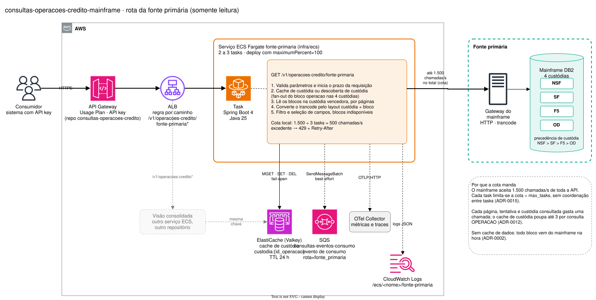
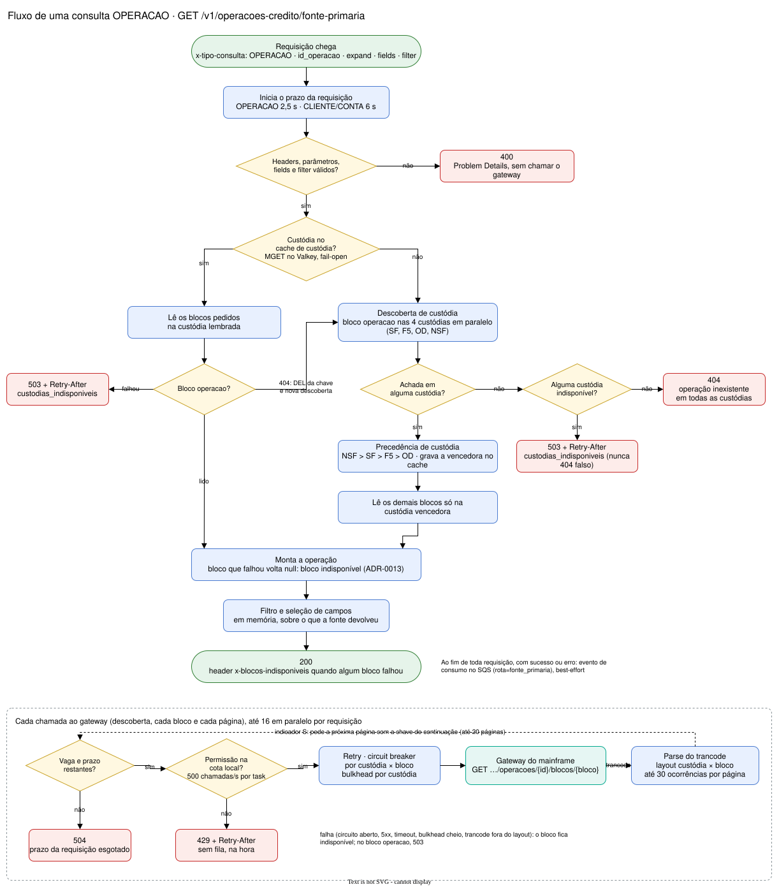

# Documentação visual

Diagramas da rota da fonte primária (`GET /v1/operacoes-credito/fonte-primaria`). Cada caixa e cada seta vem
do código ou dos ADRs da revisão `31f46e2`; os termos seguem o [`GLOSSARY.md`](../../GLOSSARY.md).

## Visão geral

Os componentes na AWS e a fonte primária: o caminho consumidor → API Gateway → ALB → serviço ECS
`fonte-primaria` → gateway do mainframe, os recursos usados pelo serviço e a cota de 1.500 chamadas/s. A visão
consolidada aparece esmaecida, só como contexto.



## Fluxo de uma consulta

O caminho de uma consulta `OPERACAO`, da validação à resposta, com os desfechos 400, 404, 429, 503 e 504. O
quadro de baixo vale para cada chamada ao gateway: prazo, cota local, resiliência, trancode e paginação.



## Componentes no código

Os componentes de uma consulta, como estão no código: borda HTTP, caso de uso, adapter da fonte primária,
resiliência e cota, e parser de trancode. A versão [interativa](arquitetura.html) liga cada caixa ao código.


## Sequência de uma consulta OPERACAO

A operação `100000007` da massa local, sem custódia no cache: fan-out do bloco `operacao` nas 4 custódias,
escolha da F5 e as 3 páginas de `parcelas`. A versão [interativa](sequencia-consulta-operacao.html) liga cada
participante ao código.


## Vídeo

[`fonte-primaria.webm`](fonte-primaria.webm) (55 s, 1080p): o que o serviço faz e por que a vazão dele é a cota
do mainframe, guiado sobre o diagrama de componentes.

## Editar e regenerar

| Artefato | Como editar | Como regenerar |
| --- | --- | --- |
| `visao-geral.drawio`, `fluxo-consulta.drawio` | Abrir no draw.io (desktop ou [app.diagrams.net](https://app.diagrams.net)). O `.svg` também abre editável: ele leva o diagrama embutido | No draw.io: *Arquivo › Exportar como › SVG*, com *Incluir uma cópia do meu diagrama* marcado, por cima do `.svg` |
| `arquitetura.html`, `arquitetura.svg` | Editar [`fontes/arquitetura.json`](fontes/arquitetura.json) (formato da [archify](https://github.com/tt-a1i/archify)) | Ver os comandos abaixo |
| `sequencia-consulta-operacao.html`, `.svg` | Editar [`fontes/sequencia-consulta-operacao.json`](fontes/sequencia-consulta-operacao.json) | Ver os comandos abaixo |
| `fonte-primaria.webm` | Editar o roteiro [`fontes/video-arquitetura.json`](fontes/video-arquitetura.json) | Ver os comandos abaixo; precisa de Chrome |

Comandos da archify, na raiz do repositório (`<archify>` é a pasta da skill instalada; os arquivos de saída
precisam ser apagados antes):

```bash
node <archify>/bin/archify.mjs finalize architecture docs/arquitetura/fontes/arquitetura.json docs/arquitetura/arquitetura.html --repo-root . --quality showcase
node <archify>/bin/export-svg.mjs docs/arquitetura/arquitetura.html docs/arquitetura/arquitetura.svg auto

node <archify>/bin/archify.mjs finalize sequence docs/arquitetura/fontes/sequencia-consulta-operacao.json docs/arquitetura/sequencia-consulta-operacao.html --repo-root . --quality showcase
node <archify>/bin/export-svg.mjs docs/arquitetura/sequencia-consulta-operacao.html docs/arquitetura/sequencia-consulta-operacao.svg auto

node <archify>/bin/archify.mjs story video docs/arquitetura/arquitetura.html docs/arquitetura/fontes/video-arquitetura.json docs/arquitetura/fonte-primaria.webm --format webm --fps 30
```

O `finalize` grava recibos (`*.finalize.json`, `*.browser-check.json`, `*.delivery.json`) ao lado do HTML; eles
não são versionados. Os JSON citam linhas do código numa revisão fixa (`meta.repository.revision`): ao mudar o
código, atualize a revisão e as linhas citadas.
